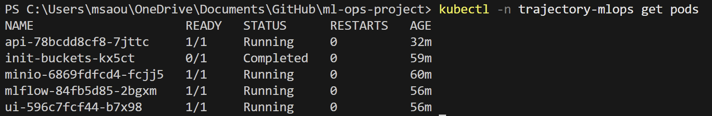
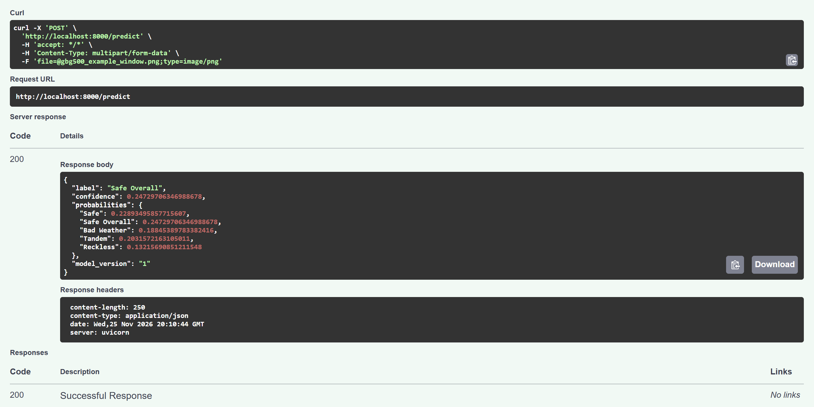
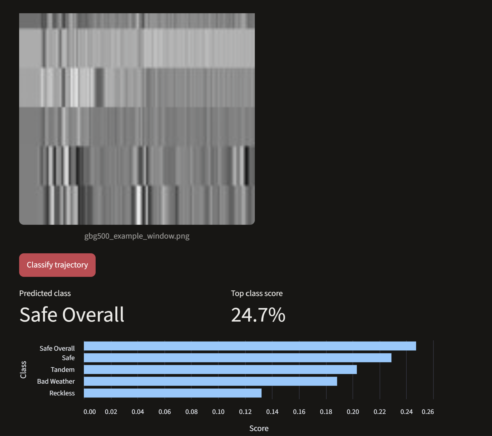
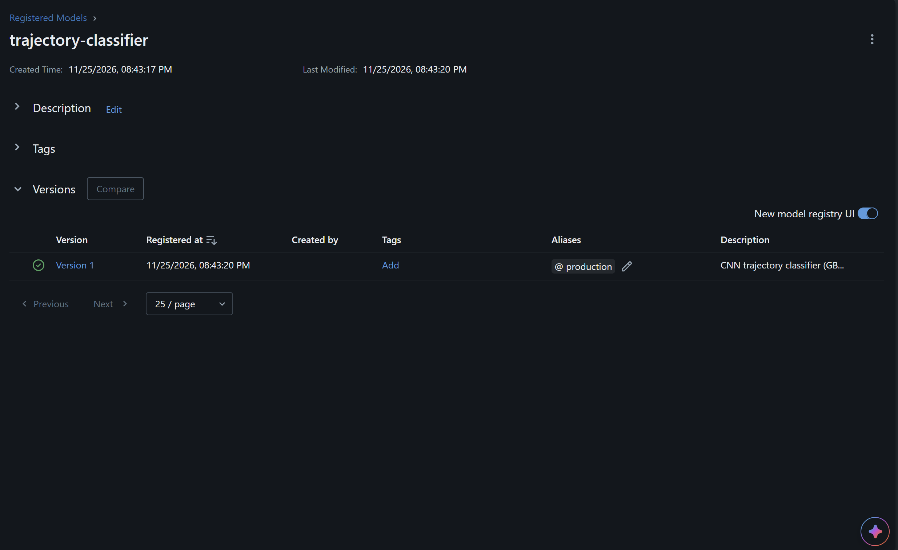

# Trajectory MLOps: ride classification

End-to-end MLOps project (Albert School, MLOps & Model Deployment, 2026-27) that
classifies ride trajectories into five classes:
**Safe, Safe Overall, Bad Weather, Tandem, Reckless**.

Phone sensor rides (accelerometer + gyroscope) are turned into images, a PyTorch CNN
is trained and tracked with MLflow, models are stored on MinIO (S3), served by a
FastAPI API with a Streamlit web app, and shipped with Docker, GitHub Actions and
Kubernetes.

## Team

| Name | Main contributions |
| --- | --- |
| Viviam Baiz | Data engineering: DVC data versioning, ride-to-image converter, split by ride, EDA, augmentation, first experiments |
| Hoang Ngoc-Tran | Model: architecture justification, hyperparameter tuning, evaluation and model handoff |
| Luna Grandjean | MLOps and backend: champion/challenger promotion, retraining workflow, API, Streamlit, API metrics |
| Dhia Ben Cheikh | DevOps and monitoring: Prometheus, Grafana dashboard and alerts |
| Malek Saoudi | To complete |

Roles and review rules: [docs/TEAM.md](docs/TEAM.md) and [CONTRIBUTING.md](CONTRIBUTING.md).

## Dates and deliverables

- **20/11/2026**: group members sent to the teachers (done).
- **25/11/2026, 20:00 Paris time**: submission (late penalty).
- **26/11/2026**: 10 min presentation + 10 min questions.
- Submission checklist: [docs/DELIVERY.md](docs/DELIVERY.md).
- Architecture and DAG: [docs/ARCHITECTURE.md](docs/ARCHITECTURE.md).

## Repository layout

```text
.
├── src/trajectory_mlops/
│   ├── data/                # parquet -> images (convert.py), manifest + split by ride (prepare.py)
│   ├── models/              # PyTorch CNN, dataset + augmentation, training, evaluation, plots
│   ├── api/                 # FastAPI: image upload, health, Swagger, Prometheus metrics
│   ├── config.py            # class list and settings shared by every component
│   ├── promote.py           # quality gate + champion/challenger promotion
│   └── retraining.py        # retraining helpers used by retrain.yml
├── app/                     # Streamlit web app that calls the API
├── data/                    # source/ (DVC), raw/ (generated images), processed/ (manifest)
├── scripts/                 # EDA, Kubernetes rendering, smoke tests, model bundle registration
├── tests/{unit,integration,e2e}/
├── k8s/                     # Kubernetes manifests (namespace, storage, apps, bucket init)
├── .github/workflows/       # CI, release (Docker Hub + Kubernetes deploy), retraining
├── docs/                    # architecture, EDA, deployment, runbook, retraining, team, screenshots
├── compose.yaml             # dev environment
├── Dockerfile               # targets: api, ui, tracking
├── dvc.yaml                 # DAG: convert -> prepare -> train -> evaluate
├── params.yaml              # versioned experiment configuration
├── pyproject.toml
└── uv.lock                  # locked dependencies (committed)
```

## Quick start (dev, Docker Compose)

Requirements: Git, [uv](https://docs.astral.sh/uv/), Docker Desktop (Linux containers).
Run the commands from the repository root.

```bash
cp .env.example .env
uv sync --frozen --extra ml --extra pipeline --extra dev
docker compose up -d --build
```

On Windows PowerShell, use `Copy-Item .env.example .env` for the first line.

Services:
- Swagger: http://localhost:8000/docs
- Web app (Streamlit): http://localhost:8501
- MLflow: http://localhost:5001 (port 5001 avoids the class TP on 5000)
- MinIO console: http://localhost:9001 (credentials in your `.env`)
- Grafana: http://localhost:3000 (user `admin`, password `GRAFANA_ADMIN_PASSWORD` from your `.env`)
- Prometheus: http://localhost:9090 (the Alerts tab lists the API alert rules)

`GRAFANA_ADMIN_PASSWORD` is required. If your `.env` was created before monitoring was
added, every `docker compose` command fails until you add that line from `.env.example`.

Before a model is configured, `/health/live` returns 200 and `/health/ready` returns 503.
The web app shows that no model is loaded.

## Data and pipeline

The data (GBG500: 500 rides, 10 Hz, 6 IMU signals, no GPS) is versioned with DVC in
`data/source/` and stored in the MinIO bucket `datasets`. Details:
[data/README.md](data/README.md) and the analysis in [docs/EDA.md](docs/EDA.md).

```bash
export AWS_ACCESS_KEY_ID=<MINIO_ROOT_USER> AWS_SECRET_ACCESS_KEY=<MINIO_ROOT_PASSWORD>
uv run dvc pull      # get the data version recorded in data/source.dvc
uv run dvc repro     # convert -> prepare -> train -> evaluate
uv run dvc dag       # show the DAG
```

| Stage | What it does |
| --- | --- |
| `convert` | Cuts each ride into 30 s windows and draws each window as a grayscale image (one band per signal, same fixed scale for every image) |
| `prepare` | Checks the images, removes duplicates and splits **by ride** (70/15/15) so windows of one ride never end up in both train and test |
| `train` | Trains the CNN, selects the best epoch on validation macro-F1, logs everything to MLflow (params, metrics, Git commit, data fingerprint, model) |
| `evaluate` | Scores the test set against the baselines, logs the confusion matrix and registers the model with the `@candidate` alias |

Results: `reports/evaluation.json` (metrics), `artifacts/run.json` (run),
`artifacts/registry.json` (registered version). To change hyperparameters, edit
`params.yaml`, commit, then run `uv run dvc repro`.

## Model architecture and evaluation

Each example is a 30-second window of accelerometer and gyroscope signals
encoded as an image with six horizontal bands. The compact PyTorch CNN uses
three convolutional blocks to detect local patterns such as sudden signal
changes. Pooling reduces sensitivity to where a pattern occurs in the window,
and a linear layer predicts one of the five classes. This architecture can be
trained from scratch on CPU and exported as TorchScript.

The data is heavily imbalanced (83% Safe, only 6 Reckless rides), so accuracy is
misleading: always answering "Safe" already scores 0.842. Models are selected and
promoted on **macro-F1**, which gives equal weight to each class. The split groups
windows by ride to prevent leakage. Training uses inverse-frequency class weights
and applies random time shifts and small amounts of noise to training images only.

### Reported experiments

| Experiment | Configuration | Test accuracy | Test macro-F1 | Reckless recall |
| --- | --- | ---: | ---: | ---: |
| 1 | CNN, 10 epochs | 0.845 | 0.268 | 4/15 (27%) |
| 2 | CNN with class weights | 0.674 | 0.319 | 11/15 (73%) |
| 3 | Class weights and augmentation | 0.692 | 0.343 | 12/15 (80%) |
| Tuned | Experiment 3, 20 epochs, learning rate 0.0005 | 0.751 | 0.360 | 11/15 (73%) |

The majority classifier reached 0.842 test accuracy and 0.183 macro-F1; random
guessing reaches 0.20 accuracy. Every model beats random guessing, and from
experiment 2 on the models clearly beat the majority baseline on macro-F1.
Bad Weather and Tandem still have zero recall: the [EDA](docs/EDA.md) shows that
these classes have few rides and motion profiles similar to Safe. Reckless recall
is measured on windows from a single test ride, which limits what the result says
about unseen Reckless rides.

[Experiment 1](docs/screenshots/confusion_matrix_experiment1.png) ·
[Experiment 2](docs/screenshots/confusion_matrix_experiment2.png) ·
[Experiment 3](docs/screenshots/confusion_matrix_experiment3.png) ·
[Tuned model](docs/screenshots/confusion_matrix_tuned.png) confusion matrices

### Champion comparison and tuning

The saved confusion matrices for experiments 2 and 3 contain the same class
supports across 736 test windows:

| Test class | Support | v2 recall | v3 recall |
| --- | ---: | ---: | ---: |
| Safe | 620 | 462/620 (74.5%) | 473/620 (76.3%) |
| Safe Overall | 48 | 23/48 (47.9%) | 24/48 (50.0%) |
| Bad Weather | 24 | 0/24 (0%) | 0/24 (0%) |
| Tandem | 29 | 0/29 (0%) | 0/29 (0%) |
| Reckless | 15 | 11/15 (73.3%) | 12/15 (80.0%) |

On these results, v3 improved macro-F1 by 0.024 and made 13 more correct
predictions. Its accuracy and macro-F1 exceed the promotion thresholds
(0.210 accuracy and about 0.183 majority-class macro-F1).

Tuning kept the data split, seed, class weights and augmentation fixed and varied
the epoch budget and the Adam learning rate:

| Epoch budget | Learning rate | Best epoch | Validation macro-F1 | Local MLflow run |
| ---: | ---: | ---: | ---: | --- |
| 10 | 0.001 | 10 | 0.3515 | First 10 epochs of the 0.001 run |
| 20 | 0.001 | 18 | 0.3663 | `fd03289cbff7485db28760c2bd4dff09` |
| 20 | 0.0005 | 18 | 0.3678 | `162082769cfd448e8c6d1ea6080e83ed` |

The checkpoint selected on validation (0.0005, epoch 18) achieved **0.3597 test
macro-F1** and **0.7514 accuracy** on 736 windows. Its recall was 84.2% for
Safe (522/620), 41.7% for Safe Overall (20/48), 0% for Bad Weather (0/24),
0% for Tandem (0/29) and 73.3% for Reckless (11/15). Compared with v3,
the tuned model improved macro-F1 by about 0.017, while recall declined for
Safe Overall and Reckless.

The tuned model passed the quality gate in a local MLflow registry. The deployment
team can register the evaluated bundle in the Kubernetes MLflow registry without
retraining: see [Person 2 model handoff](docs/DEPLOYMENT.md#person-2-model-handoff).

## Promote and serve the model

Read the version in `artifacts/registry.json`, then replace `1` below:

```bash
uv run python -m trajectory_mlops.promote --version 1
```

The promotion gate requires test accuracy above uniform random guessing (20%),
test accuracy of at least the configured threshold (21%), and test macro-F1 above
the majority-class baseline. When `@production` exists, promotion also requires
a matching dataset/split fingerprint and a strictly higher macro-F1
(champion vs. challenger). Use `--dry-run` to preview the decision, or
`--output artifacts/promotion.json` to save it. A skipped promotion exits
successfully with `promoted=false`; automation must check that flag before
releasing. See the [promotion policy](docs/RETRAINING.md).

In `.env`, set:

```dotenv
MODEL_URI=models:/trajectory-classifier@production
```

Then restart the API (aliases are resolved at startup) and send a real image:

```bash
docker compose up -d --force-recreate api ui
uv run python scripts/smoke_api.py --image "data/raw/Safe/<RIDE_ID>_w00.png"
```

## Tests

```bash
uv run python -m ruff check .
uv run python -m ruff format --check .
uv run python -m pytest -m "not ml and not e2e"   # fast unit and integration tests
uv run python -m pytest -m ml                     # tests that need PyTorch and MLflow
```

ML integration tests cover a tiny synthetic training pipeline and the import and
HTTP serving of the evaluated handoff model in an isolated SQLite registry. They do
not change the team registry or claim new accuracy results. To test the deployed
service end to end with a real image:

```bash
E2E_API_URL=http://localhost:8000 E2E_IMAGE_PATH="data/raw/Safe/<RIDE_ID>_w00.png" \
  uv run python -m pytest -m e2e
```

## Kubernetes, CI/CD and collaboration

- Dev: Docker Compose. Production: local Kubernetes cluster (Docker Desktop).
- CI (`ci.yml`): lint, tests, synthetic ML integration test and Docker build of the
  three images on every pull request and on `main`.
- Release (`release.yml`): on a Git tag `v*` (or manual run), publishes the three
  images to Docker Hub tagged with the commit SHA, then deploys to Kubernetes when
  `ENABLE_K8S_DEPLOY=true`, through a trusted self-hosted Mac runner (labels
  configurable with `MLOPS_RUNNER_LABELS`) and the GitHub `production` environment.
- Retraining (`retrain.yml`): pulls the data with DVC, reruns the DAG, smoke-checks
  the candidate, promotes it only if it beats the champion, then triggers a release.
- The cluster MLflow registry is separate from the Compose one: a model must be
  registered in the target registry before the API can load it.
- Procedure, secrets and first setup: [docs/DEPLOYMENT.md](docs/DEPLOYMENT.md).
- Every change goes through a pull request reviewed by another member:
  [CONTRIBUTING.md](CONTRIBUTING.md).

## Backend, retraining and monitoring

- [API and Streamlit guide](docs/BACKEND.md): readiness, model metadata, upload
  validation, five confidence scores, error handling and demo commands.
- [Retraining and promotion](docs/RETRAINING.md): manual dry run, DVC retrieval,
  artifact smoke check, comparable champion/challenger gate and automatic release
  only for an improved candidate. Releases pin both the code SHA and a numbered model URI.
- [API monitoring](docs/API_MONITORING.md): Prometheus endpoint and metric names,
  the provisioned Grafana dashboard and the alert rules (`infra/prometheus`, `infra/grafana`).
- Operations, data versioning and rollback: [docs/RUNBOOK.md](docs/RUNBOOK.md).

## Delivery status

| Item | Value |
| --- | --- |
| Dataset version (DVC) | `data/source.dvc`, md5 `3dcf214a691b6aef5661f099c28fa843.dir` |
| Split and leakage prevention | Split by ride, 70/15/15, at least one ride per class in each split |
| Model experiments and majority baseline | See [reported experiments](#reported-experiments) |
| Release | Tag `v0.1.0`, commit `64acc95243abe42d911384b68989f88bb9e63a43` |
| Docker Hub images | [dbc0207/trajectory-api](https://hub.docker.com/r/dbc0207/trajectory-api), [dbc0207/trajectory-ui](https://hub.docker.com/r/dbc0207/trajectory-ui), [dbc0207/trajectory-tracking](https://hub.docker.com/r/dbc0207/trajectory-tracking), tag = release commit SHA `64acc95243abe42d911384b68989f88bb9e63a43` (public, linux/amd64) |
| Kubernetes deployment | Release images on Docker Desktop Kubernetes, model `trajectory-classifier` v1 `@production`, real prediction served with `model_version: "1"` (see screenshots) |
| Screenshots | See [Deployment evidence](#deployment-evidence) |

## Deployment evidence

Local Kubernetes (Docker Desktop), namespace `trajectory-mlops`, release images `64acc95`.

**Pods:** API, web app, MLflow and MinIO ready, no restarts; the bucket job completed.



**Swagger:** `POST /predict` with a GBG500 window image returns the label, the five scores and `model_version`.



**Web app:** the same image gives the same prediction, with the score of each class.



**MLflow:** the registered model `trajectory-classifier`, version 1 under the `@production` alias that the API loads.


