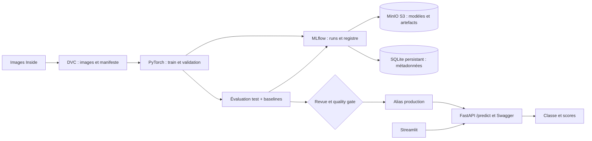
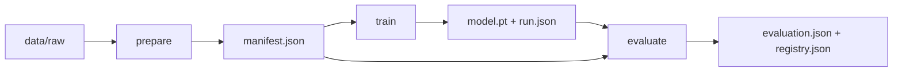

# Architecture et choix techniques

Le projet traite les images de trajectoires des consignes Inside. Les classes et
leur ordre sont définis une seule fois dans `config.py`. Le format des données
Inside reste à confirmer, notamment les groupes trajet/conducteur.

DAG fonctionnel défini dans `dvc.yaml` :

DVC est l'orchestrateur retenu pour les trois étapes du batch : dépendances,
paramètres, cache et visualisation du DAG via `dvc dag`. Airflow n'est pas requis
par les consignes (« Airflow ou autre »). GitHub Actions orchestre les vérifications,
la construction/publication des images et le déploiement ; le workflow de
réentraînement déclenche le DAG sur un runner disposant des services et données.

| Composant | Responsabilité et choix |
| --- | --- |
| PyTorch / petit CNN | Baseline deep learning, CPU, améliorable sans modifier l'API |
| Prétraitement partagé | RGB, resize et normalisation identiques train/inférence |
| DVC | Version des données et DAG reproductible |
| MLflow | Paramètres, métriques, commit, fingerprint, modèle et versions |
| MinIO | Stockage S3 des poids et artefacts ; backend séparé des métadonnées |
| SQLite sur volume | Métadonnées MLflow ; une seule réplique pour ce projet local |
| FastAPI | Upload PNG/JPEG, validation et contrat OpenAPI/Swagger |
| Streamlit | Test manuel depuis une interface utilisateur |
| Compose | Services de développement avec volumes nommés |
| Kubernetes | Production locale : Deployments, Services, PVC et probes |
| GitHub Actions / Docker Hub | CI, trois images taguées par SHA et CD configurable |

L'API charge une version au démarrage, résout l'alias en numéro puis utilise cette
version pour toutes les requêtes du processus. Pour changer d'alias, redémarrer
le déploiement ; pour un rollback précis, définir une URI `models:/nom/NUMERO`.

Les runs de dev et de production sont séparés. La promotion d'un alias dans dev ne
crée pas le modèle sur le cluster. Il faut entraîner contre le tracking server du
cluster ou organiser un transfert explicite des modèles et métadonnées.

Limites assumées du socle :
- Une image indépendante par trajectoire ; split groupé à ajouter si nécessaire.
- Le test final ne doit pas servir au réglage répété des hyperparamètres.
- Pas de monitoring Prometheus/Grafana ni de feature store pour le moment.
- SQLite et MinIO à une réplique adaptés à la démonstration locale, sans haute disponibilité.
- Images de base et outils : fixer les digests après le premier build réussi ;
  le client MinIO utilise encore `latest`.

Références officielles :
- [MLflow PyTorch](https://mlflow.org/docs/latest/api_reference/python_api/mlflow.pytorch.html)
- [MLflow Artifact Store](https://mlflow.org/docs/latest/self-hosting/architecture/artifact-store/)
- [Protection réseau MLflow](https://mlflow.org/docs/latest/self-hosting/security/network/)
- [DAG et dvc.yaml](https://doc.dvc.org/user-guide/project-structure/dvcyaml-files)
