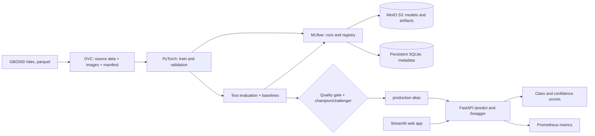
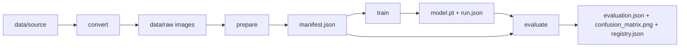

# Architecture and technical choices

The project classifies ride trajectories (GBG500 phone sensor data from Inside) into
five classes. The classes and their order are defined once, in `config.py`.

Working DAG defined in `dvc.yaml`:

DVC is the orchestrator for the batch steps: dependencies, parameters, cache and DAG
visualisation with `dvc dag`. Airflow is not required by the brief ("Airflow or other").
GitHub Actions orchestrates checks, image build and publication, and deployment; the
retraining workflow runs the DAG on a runner that can reach the services and the data.

| Component | Responsibility and choice |
| --- | --- |
| Ride → image converter | 30 s windows, one band per signal, same fixed scale for every image |
| PyTorch / small CNN | Deep learning model trained from scratch on CPU, exported as TorchScript |
| Shared preprocessing | Same RGB conversion, resize and normalisation for training and inference |
| DVC | Data versioning (MinIO remote) and reproducible DAG |
| MLflow | Parameters, metrics, Git commit, data fingerprint, model and versions |
| MinIO | S3 storage for weights and artifacts; separate from the metadata backend |
| SQLite on a volume | MLflow metadata; a single replica for this local project |
| FastAPI | PNG/JPEG upload, validation, OpenAPI/Swagger contract, Prometheus metrics |
| Streamlit | Manual testing from a web interface |
| Compose | Development services with named volumes |
| Kubernetes | Local production: Deployments, Services, PVCs and probes |
| GitHub Actions / Docker Hub | CI, three images tagged by commit SHA, configurable CD and retraining |

The API loads one model version at startup, resolves the alias to a version number,
then uses that version for every request of the process. To switch aliases, restart
the deployment; for an exact rollback, set a `models:/name/NUMBER` URI.

Dev and production runs are separate. Promoting an alias in dev does not create the
model on the cluster: either train against the cluster tracking server or explicitly
transfer the model (see the model handoff in [DEPLOYMENT.md](DEPLOYMENT.md)).

Known limitations:
- The final test set must not be used for repeated hyperparameter tuning.
- Few rides for the rare classes (6 Reckless rides): test results for those classes
  rely on one or two rides.
- No feature store.
- Single-replica SQLite and MinIO, suited to a local demonstration, without high availability.
- MinIO images are the community builds `pgsty/minio` and `pgsty/mc` at pinned
  versions (the official images are no longer published).

Official references:
- [MLflow PyTorch](https://mlflow.org/docs/latest/api_reference/python_api/mlflow.pytorch.html)
- [MLflow artifact store](https://mlflow.org/docs/latest/self-hosting/architecture/artifact-store/)
- [MLflow network protection](https://mlflow.org/docs/latest/self-hosting/security/network/)
- [DAG and dvc.yaml](https://doc.dvc.org/user-guide/project-structure/dvcyaml-files)
