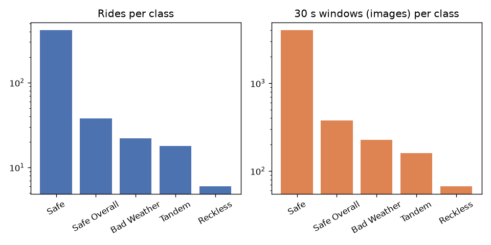
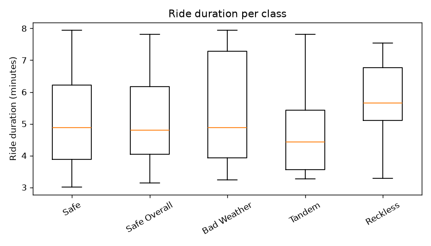
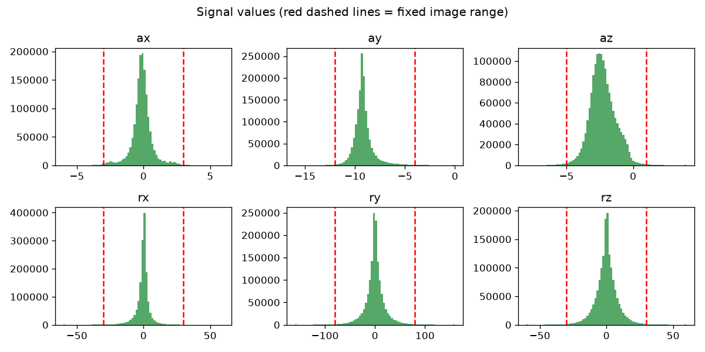
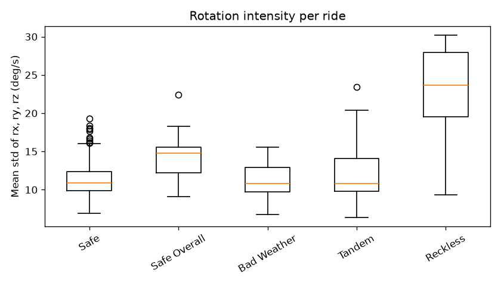
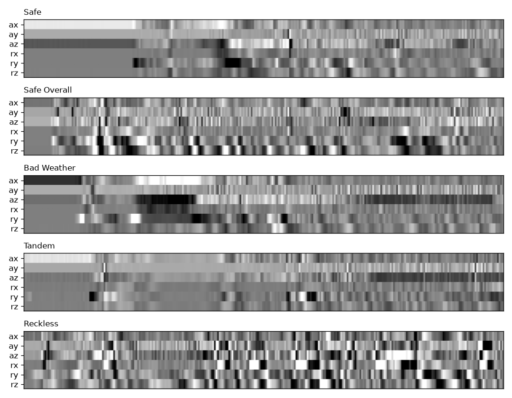

# Exploratory data analysis (GBG500)

Reproduce every number and chart below with:

```bash
uv run python scripts/eda.py
```

## 1. The data

- **500 rides** recorded in Gothenburg, **1,529,547 rows** in total.
- One row every **100 ms (10 Hz)** with 6 phone sensor signals:
  `ax, ay, az` (acceleration, m/s²) and `rx, ry, rz` (rotation speed, deg/s). No GPS.
- **10,201 empty rows (0.7%)**: when a row is missing, all 6 signals are missing together.
  `convert.py` fills them from the neighbouring values (interpolation).
- `ay` is centred around **-9.2 m/s²**: this is gravity, so the phone is mostly held in the
  same orientation.

## 2. Class balance: very imbalanced



| Class | Rides | Share | 30 s windows (images) | Median duration |
| --- | ---: | ---: | ---: | ---: |
| Safe | 416 | 83.2% | 4,021 | 4.9 min |
| Safe Overall | 38 | 7.6% | 375 | 4.8 min |
| Bad Weather | 22 | 4.4% | 226 | 4.9 min |
| Tandem | 18 | 3.6% | 160 | 4.4 min |
| Reckless | 6 | 1.2% | 67 | 5.7 min |

**Consequences for the pipeline:**

- **Accuracy is misleading**: always answering "Safe" already scores ~0.84. We select and
  promote models with **macro-F1** (every class counts the same) and report per-class recall.
- **Cutting rides into 30 s windows** turns 6 Reckless rides into 67 images.
- **Split by ride, not by image**: windows of the same ride look alike, so all windows of a
  ride go to the same split (train, validation or test). This removed 387 rides that had
  windows in both train and test.
- **Class weights** in the loss (experiment 2) make a Reckless mistake cost ~75x a Safe one.

## 3. Ride duration does not give the class away



Rides last 3 to 8 minutes, with similar medians in every class (4.4 to 5.7 min). The model
cannot "cheat" by using the duration, and every class gets a comparable number of windows
per ride (~10).

## 4. The fixed image scale keeps 99% of the detail



Each signal is drawn with the **same fixed range in every image** (red dashed lines,
`convert.ranges` in `params.yaml`), so a strong shake looks dark in every ride. Only
**0.5% to 1.1%** of the values fall outside the range and are clipped:

| ax | ay | az | rx | ry | rz |
| ---: | ---: | ---: | ---: | ---: | ---: |
| 0.81% | 1.13% | 0.97% | 0.48% | 1.02% | 0.92% |

## 5. Reckless rides rotate twice as much; Bad Weather and Tandem look like Safe



Median rotation intensity (mean standard deviation of `rx, ry, rz`, deg/s):

| Safe | Safe Overall | Bad Weather | Tandem | Reckless |
| ---: | ---: | ---: | ---: | ---: |
| 10.9 | 14.8 | 10.8 | 10.8 | **23.7** |

This explains the model results:

- **Reckless** is clearly separable (about 2x more rotation): experiment 2 detects 73% of
  Reckless windows and never confuses them with Safe.
- **Safe Overall** is slightly more agitated than Safe, which matches its description
  ("near the decision boundary") and why the model confuses the two.
- **Bad Weather and Tandem** have the same rotation profile as Safe. With only 22 and 18 rides,
  the model does not learn to tell them apart (recall 0 in experiments 1 and 2).

## 6. What the model sees



One 30 s window per class (first window of the first ride, light = low value, dark = high).
Several rides **start with a flat segment** (the phone is still before the ride starts):
these windows carry little information and could be filtered out in a future iteration.

## Key takeaways

1. Heavily imbalanced data → macro-F1, class weights, split by ride.
2. Duration is not a shortcut; the fixed image scale loses only ~1% of the values.
3. Rotation intensity separates Reckless well; Bad Weather and Tandem need more data or
   other signals (e.g. frequency content) to be detected.